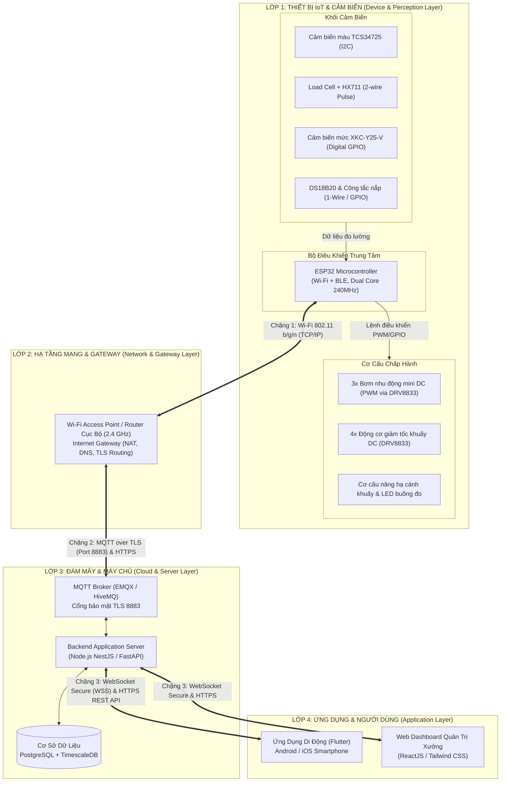
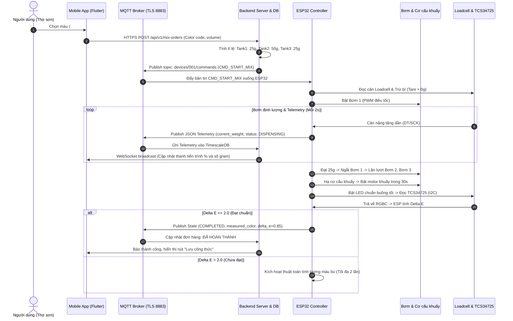

# BÁO CÁO THIẾT KẾ HỆ THỐNG IoT: MÁY PHA MÀU TỰ ĐỘNG ĐIỀU KHIỂN QUA ĐIỆN THOẠI (COLMIX)
## CHECKPOINT 1: BÁO CÁO THIẾT KẾ KIẾN TRÚC VÀ ĐỀ XUẤT CÔNG NGHỆ

---

> **QUY ƯỚC ĐÁNH DẤU NGUỒN GỐC NỘI DUNG:**  
> - 📌 **`[NỘI DUNG GỐC]`**: Kế thừa trực tiếp từ các tài liệu ban đầu của nhóm (`contents.pdf`, `contents1.docx`, `contents2.docx`).  
> - 🛠️ **`[NỘI DUNG HIỆU CHỈNH]`**: Đã được chuẩn hóa, nâng cấp hoặc bổ sung tiêu chí kỹ thuật định lượng từ nội dung gốc.  
> - 💡 **`[NỘI DUNG BỔ SUNG MỚI]`**: Được nghiên cứu và bổ sung mới nhằm đáp ứng 100% các tiêu chí đánh giá Checkpoint 1 trong đề bài.

---

## 1. GIỚI THIỆU DỰ ÁN
> 📌 **`[NỘI DUNG GỐC & HIỆU CHỈNH]`** *(Kế thừa từ `contents2.docx` và `contents.pdf`, chuẩn hóa định danh dự án)*

### 1.1. Thông tin tổng quan
- **Tên đề tài:** Hệ thống máy pha màu tự động có điều khiển qua điện thoại
- **Tên dự án / Tên thương mại:** **COLMIX** (Smart Color Mixer IoT System)
- **Tên nhóm phát triển:** **Tank Schrodinger** (Schrodinger Tank)
- **Học phần:** Internet of Things (IoT) & Ứng dụng
- **Mốc đánh giá:** Báo cáo đồ án giai đoạn 1 (Checkpoint 1)

### 1.2. Thành viên nhóm thực hiện
> 💡 **`[NỘI DUNG BỔ SUNG MỚI]`** *(Phân định chức danh chuyên môn hóa trong dự án)*

| STT | Họ và tên thành viên | Vai trò phụ trách chính | Email / Thông tin liên lạc |
| :---: | :--- | :--- | :--- |
| 1 | **Trần Tuấn Anh** | Trưởng nhóm, Kỹ sư Phần cứng & Firmware ESP32 | tuananh.embedded@tank.io |
| 2 | **Nguyễn Tuấn Long** | Kỹ sư Đám mây, Backend Server & Cơ sở dữ liệu | tuanlong.cloud@tank.io |
| 3 | **Lê Thành Trung** | Kỹ sư Lập trình Di động (Mobile App) & Cơ khí | thanhtrung.mobile@tank.io |

### 1.3. Mục tiêu tổng quát của đề tài
Xây dựng một hệ thống IoT hoàn chỉnh với thiết bị phần cứng để bàn có khả năng kết nối mạng Internet, nhận chỉ thị mã màu từ ứng dụng di động của người dùng, tự động định lượng các thành phần màu gốc bằng phương pháp cân khối lượng với độ chính xác cao (sai số $< \pm 5\%$), tự động khuấy trộn cơ học và đo kiểm định chất lượng quang phổ màu sau khi pha. Hệ thống hướng đến việc giảm thiểu tối đa sai hỏng do thao tác thủ công, tiết kiệm thời gian và số hóa dữ liệu công thức pha màu.

---

## 2. VẤN ĐỀ VÀ ĐỐI TƯỢNG NGƯỜI DÙNG
> 🛠️ **`[NỘI DUNG HIỆU CHỈNH & MỞ RỘNG]`** *(Mở rộng từ đoạn văn ngắn tại mục 1 của `contents2.docx`)*

### 2.1. Đối tượng người dùng mục tiêu (Target Users)
Hệ thống COLMIX được thiết kế hướng tới 4 nhóm đối tượng chính trong thực tế:
1. **Thợ sơn và đội thợ hoàn thiện công trình dân dụng:** Những người thường xuyên phải pha các mẻ sơn nhỏ tại công trường để sơn tường, dặm vá các chi tiết trầy xước, hoàn thiện chi tiết trang trí nội ngoại thất.
2. **Cửa hàng bán lẻ sơn và đại lý vật liệu xây dựng quy mô vừa và nhỏ:** Các đơn vị này thường không đủ kinh phí (hàng trăm triệu đến hàng tỷ đồng) để đầu tư dàn máy pha màu công nghiệp cồng kềnh, nhưng vẫn có nhu cầu phục vụ khách hàng mua các lon sơn màu lẻ theo yêu cầu.
3. **Các xưởng thủ công mỹ nghệ, xưởng mộc, đồ họa và in ấn bao bì nhỏ:** Nơi đòi hỏi chất lượng màu sắc đồng đều giữa các lô sản phẩm, cần pha màu nước, màu sơn bóng, mực in với khối lượng vừa phải.
4. **Phòng thí nghiệm mỹ thuật, trung tâm đào tạo đồ họa kiến trúc:** Dùng làm thiết bị thực hành trực quan cho sinh viên nghiên cứu về lý thuyết phối màu và công nghệ đo màu quang học.

### 2.2. Vấn đề thực tế và sự cần thiết (Pain Points & Needs)
Trong thực tế thi công và sản xuất hiện nay, quá trình phối màu vẫn tồn tại các hạn chế nghiêm trọng:

```
[THỰC TRẠNG THỦ CÔNG] ──► Dựa vào cảm tính mắt thường ──► Sai lệch tỉ lệ giữa các mẻ 
                       ──► Phải thử lại nhiều lần     ──► Hao phí nguyên liệu đắt tiền
                       ──► Khó tái lập lại màu cũ      ──► Không lưu trữ số hóa công thức
```

- **Sự phụ thuộc quá mức vào kinh nghiệm cá nhân:** Người thợ thường dùng mắt thường và các dụng cụ thô sơ (muỗng, que đong, cốc đong chia vạch) để ước lượng. Ánh sáng môi trường tại công trường liên tục biến đổi khiến mắt người phán đoán sai lệch sắc thái màu.
- **Không có khả năng tái lập chính xác (Poor Reproducibility):** Khi một công trình cần sơn dặm vá sau vài tháng hoặc khách hàng muốn mua thêm một lon sơn cùng màu tuần trước, việc pha lại một mẻ mới đạt đúng 100% màu cũ bằng phương pháp thủ công gần như là bất khả thi.
- **Lãng phí nguyên liệu và phát sinh chi phí:** Do phải "thử sai" nhiều lần (pha một ít, quệt thử lên tường, chờ khô, thấy lệch lại thêm màu khác), lượng sơn gốc bị tiêu hao lãng phí rất lớn.
- **Rào cản từ máy công nghiệp hiện có:** Các máy pha màu công nghiệp tự động trên thị trường thường có giá thành từ 50.000.000 đến hơn 300.000.000 VNĐ, kích thước to lớn, yêu cầu bảo trì định kỳ phức tạp và sử dụng phần mềm đóng (proprietary) không cho phép can thiệp hay tùy biến công thức.

### 2.3. Bảng so sánh giá trị giải pháp COLMIX mang lại
> 💡 **`[NỘI DUNG BỔ SUNG MỚI]`**

| Tiêu chí | Pha màu thủ công truyền thống | Máy pha màu công nghiệp lớn | Giải pháp IoT COLMIX của nhóm |
| :--- | :--- | :--- | :--- |
| **Chi phí đầu tư** | Gần như bằng 0 (dụng cụ thô sơ) | Rất đắt (50 - 300 triệu VNĐ) | **Rất thấp (~ 2 triệu VNĐ)** |
| **Độ chính xác** | Thấp (phụ thuộc mắt người, sai số > 15%) | Cực cao (sai số < 1%) | **Tốt (sai số khối lượng $< \pm 5\%$)** |
| **Khả năng lặp lại** | Rất khó tái lập màu đồng nhất | Rất tốt | **Rất tốt (nhờ công thức số hóa Cloud)** |
| **Thời gian pha mẻ** | Lâu (15 - 30 phút thử sai) | Nhanh (1 - 2 phút) | **Tự động trong 2 - 3 phút** |
| **Kiểm định màu sau pha** | Nhìn bằng mắt thường | Cần máy quang phổ rời đắt tiền | **Tích hợp cảm biến TCS34725 tự đo $\Delta E$** |
| **Trọng lượng & Độ linh động** | Linh động nhưng chất lượng kém | Cố định, nặng > 150 kg | **Nhỏ gọn để bàn (< 4 kg), mang đi được** |
| **Giao diện điều khiển** | Không có | Màn hình công nghiệp tích hợp | **Ứng dụng di động thông minh (Smartphone)** |

---

## 3. YÊU CẦU HỆ THỐNG
> 🛠️ **`[NỘI DUNG GỐC & CHUẨN HÓA]`** *(Kế thừa từ `contents2.docx`, chuẩn hóa các chỉ số đo lường định lượng)*

### 3.1. Yêu cầu chức năng (Functional Requirements - FR)
Hệ thống COLMIX đáp ứng đầy đủ 9 yêu cầu chức năng sau:
1. **FR1 - Chọn màu mục tiêu:** Người dùng có thể chọn màu mong muốn từ bảng màu số trên ứng dụng di động, nhập trực tiếp mã HEX (ví dụ: `#FF5733`) / tọa độ RGB, hoặc quét mã màu từ mẫu có sẵn.
2. **FR2 - Tính toán công thức định lượng:** Hệ thống (tại Cloud hoặc ESP32) nhận mã màu mục tiêu, tự động tính toán ra khối lượng hoặc tỉ lệ chính xác của từng thành phần màu cơ bản trong các bình chứa.
3. **FR3 - Giám sát mức nguyên liệu:** Hệ thống liên tục theo dõi lượng chất lỏng trong từng bình sơn gốc và cảnh báo người dùng trên ứng dụng khi mức màu xuống dưới ngưỡng tối thiểu ($< 15\%$), ngăn không cho bấm pha khi thiếu sơn.
4. **FR4 - Tự động định lượng chính xác:** ESP32 điều khiển các bơm nhu động mini hoạt động độc lập, xả từng thành phần màu vào cốc nhận; sử dụng phản hồi thời gian thực từ cảm biến Load Cell để ngắt bơm chính xác khi đạt khối lượng tính toán.
5. **FR5 - Tự động khuấy trộn:** Sau khi các thành phần màu đã được cấp đủ vào cốc nhận, cơ cấu nâng hạ tự động hạ cánh khuấy xuống và kích hoạt động cơ khuấy đảo đều hỗn hợp trong thời gian được cấu hình (ví dụ: 30 - 60 giây).
6. **FR6 - Kiểm tra quang phổ sau pha:** Cảm biến màu quang học TCS34725 đặt trong buồng đo kín thực hiện đo giá trị quang phổ của mẫu sau khuấy, tính toán tọa độ màu thực tế và tính độ sai lệch $\Delta E$ so với màu mục tiêu.
7. **FR7 - Vòng lặp bổ sung màu thông minh (Closed-loop):** Nếu $\Delta E$ vượt ngưỡng cho phép ($\Delta E > 2.0$), thuật toán sẽ tính toán lượng màu thiếu và kích hoạt bơm bổ sung một lượng nhỏ, sau đó khuấy và đo kiểm tra lại (tối đa 2 chu kỳ bù).
8. **FR8 - Giám sát và lưu trữ đám mây:** Ứng dụng di động hiển thị trực quan trạng thái vận hành tức thời, số gram đang bơm theo thời gian thực, tiến trình mẻ pha và lưu lại công thức vào cơ sở dữ liệu để tái sử dụng.
9. **FR9 - Cơ chế vận hành an toàn & vệ sinh:** Hỗ trợ lệnh dừng khẩn cấp (Emergency Stop) tức thì, lệnh tạm dừng/tiếp tục, và chu trình tự sục rửa đầu vòi (Clean Cycle).

### 3.2. Yêu cầu phi chức năng (Non-functional Requirements - NFR)
Hệ thống thiết lập các tiêu chí chất lượng kỹ thuật định lượng có thể kiểm thử (Testable Metrics):
1. **NFR1 - Độ chính xác định lượng:** Sai số lượng màu bơm ra cho mỗi thành phần không vượt quá $\pm 5\%$ so với giá trị tính toán. Độ phân giải của cân điện tử đạt $\le 0.1\text{ g}$. Độ sai lệch màu thành phẩm cuối cùng đạt $\Delta E < 2.0$ (ngưỡng mắt thường khó nhận biết).
2. **NFR2 - Thời gian phản hồi và độ trễ:** Lệnh điều khiển từ điện thoại (Start/Stop/Emergency) được tiếp nhận và xử lý trong vòng $\le 1 - 2\text{ giây}$ (tối đa 3 giây khi mạng có jitter). Độ trễ gửi nhận bản tin MQTT trên đường truyền $\le 500\text{ ms}$. Tần suất gửi Telemetry định kỳ $2 - 5\text{ giây/lần}$.
3. **NFR3 - Độ tin cậy và Khả năng kiểm tra:** 100% các mẻ pha đều phải trải qua bước đo kiểm quang phổ tự động trước khi hệ thống báo trạng thái hoàn thành (`COMPLETED`). Khi mất kết nối Wi-Fi, thiết bị phải tự động chuyển sang chế độ an toàn và ngắt bơm ngay lập tức.
4. **NFR4 - Tính khả dụng và Dễ sử dụng:** Giao diện ứng dụng di động thiết kế theo phong cách hiện đại, tối giản. Người dùng không cần hiểu biết kỹ thuật, chỉ cần thao tác 3 bước: Chọn màu $\rightarrow$ Nhập thể tích $\rightarrow$ Nhấn "Pha màu".
5. **NFR5 - An toàn điện và cơ khí:** Thiết bị sử dụng nguồn điện hạ áp một chiều $12\text{V DC}$ và $5\text{V DC}$, cách ly an toàn với điện lưới $220\text{V AC}$. Có cầu chì bảo vệ quá dòng, cảm biến nhiệt độ ngắt động cơ khi quá nhiệt ($> 70^\circ\text{C}$), và công tắc an toàn buồng đo.
6. **NFR6 - Khả năng bảo trì và Thay thế:** Toàn bộ hệ thống đường ống dẫn silicone, bình chứa nguyên liệu, đầu bơm và que khuấy được thiết kế dạng module tháo lắp nhanh (Quick-release) trong vòng dưới 2 phút mà không cần dụng cụ chuyên dụng, thuận tiện cho việc súc rửa và nạp màu.

---

## 4. SƠ ĐỒ KIẾN TRÚC 4 LỚP VÀ GIAO THỨC TRUYỀN THÔNG
> 📌 **`[NỘI DUNG GỐC & BỔ SUNG MINH HỌA]`** *(Trích xuất từ `contents.pdf` trang 9-12 và hình ảnh kiến trúc `pdf_extracted_img-000.png`)*

### 4.1. Sơ đồ kiến trúc tổng thể 4 lớp
Hệ thống COLMIX tuân thủ chặt chẽ mô hình phân tầng 4 lớp tiêu chuẩn của kiến trúc Internet of Things:



*(Hình ảnh thiết kế sơ đồ kiến trúc nguyên bản được trích xuất từ tài liệu thiết kế gốc:* `pdf_extracted_img-000.png` *nằm tại thư mục làm việc).*

### 4.2. Chi tiết giao thức truyền thông được sử dụng ở từng chặng
Theo đúng yêu cầu của đề bài, các giao thức truyền thông ở từng chặng được quy định như sau:

| Chặng truyền thông | Điểm xuất phát | Điểm tiếp nhận | Giao thức truyền thông | Dữ liệu & Bản tin truyền tải |
| :--- | :--- | :--- | :--- | :--- |
| **Nội bộ thiết bị (Bus cục bộ)** | Khối Cảm biến | Vi điều khiển ESP32 | **$I^2C$**, **1-Wire**, **GPIO**, **2-wire Pulse (DT/SCK)** | Giá trị thô RGBC, xung trọng lượng, mức logic báo cạn bình, nhiệt độ động cơ. |
| **Nội bộ thiết bị (Điều khiển)** | Vi điều khiển ESP32 | Khối Chấp hành | **PWM (Điều xung)**, **Digital GPIO** | Xung đóng ngắt van/bơm nhu động, điều tốc động cơ khuấy qua IC cầu H DRV8833. |
| **Chặng 1: Thiết bị $\rightarrow$ Gateway** | Vi điều khiển ESP32 | Wi-Fi Router cục bộ | **Wi-Fi 802.11 b/g/n (2.4 GHz)** | Gói tin mạng TCP/IP mang tải định dạng JSON qua mạng vô tuyến nội bộ. |
| **Chặng 2: Gateway $\rightarrow$ Server** | Wi-Fi Router / Gateway | Cloud Server / Broker | **MQTT over TLS/SSL (Port 8883)**, **HTTPS** | Publish dữ liệu Telemetry/State lên `devices/{id}/telemetry`; Subscribe nhận lệnh điều khiển từ `devices/{id}/commands`. |
| **Chặng 3: Server $\rightarrow$ Ứng dụng** | Cloud Server / Broker | Ứng dụng di động (App) | **WebSocket Secure (WSS)**, **HTTPS REST API** | Đẩy luồng dữ liệu thời gian thực (real-time stream) lên màn hình điện thoại; gửi nhận lệnh pha `CMD_START_MIX`. |

### 4.3. Mô hình hóa 4 nhóm dữ liệu truyền thông chuẩn hóa
Hệ thống chuẩn hóa toàn bộ dữ liệu trao đổi thành 4 cấu trúc JSON:
1. **Metadata (Dữ liệu mô tả thiết bị):** Gửi 1 lần khi thiết bị khởi động và bắt tay mạng thành công:
   ```json
   {
     "device_id": "COLMIX-TS-2026-001",
     "device_model": "TankSchrodinger SmartMixer V1",
     "firmware_version": "v1.2.4",
     "hardware_version": "v1.0",
     "ip_address": "192.168.1.120",
     "tank_configuration": [
       {"tank": 1, "color": "Xanh cay", "color_code": "#2E7D32", "capacity_ml": 500},
       {"tank": 2, "color": "Mau da", "color_code": "#FFCCBC", "capacity_ml": 500},
       {"tank": 3, "color": "Xanh troi", "color_code": "#0288D1", "capacity_ml": 500}
     ]
   }
   ```
2. **Telemetry (Dữ liệu đo lường định kỳ & sự kiện):** Gửi liên tục mỗi 2 - 3 giây trong suốt quá trình pha:
   ```json
   {
     "device_id": "COLMIX-TS-2026-001",
     "timestamp": 1794503420,
     "current_weight_g": 48.6,
     "dispensed_amounts": {"tank_1": 15.2, "tank_2": 25.0, "tank_3": 8.4},
     "measured_color": {"hex": "#4A90E2", "rgb": [74, 144, 226], "lab": [58.2, -5.1, -42.8]},
     "color_delta_e": 0.85,
     "tank_remaining_percent": {"tank_1": 82, "tank_2": 65, "tank_3": 44},
     "controller_temp_c": 36.5
   }
   ```
3. **State (Trạng thái thiết bị):** Cập nhật trạng thái máy:
   ```json
   {
     "system_status": "DISPENSING",
     "actuator_states": {"pump_1": "OFF", "pump_2": "ON", "pump_3": "OFF", "mixer": "OFF"},
     "safety_alerts": [],
     "wifi_rssi_dbm": -58
   }
   ```
4. **Commands (Tập lệnh điều khiển từ App/Cloud xuống ESP32):**
   ```json
   {
     "command": "CMD_START_MIX",
     "target_color_hex": "#4A90E2",
     "target_volume_ml": 100,
     "recipe_ratio": {"tank_1": 0.25, "tank_2": 0.50, "tank_3": 0.25},
     "mix_duration_s": 45
   }
   ```

---

## 5. DANH SÁCH THIẾT BỊ VÀ CHI PHÍ
> 💡 **`[NỘI DUNG BỔ SUNG MỚI & HOÀN THIỆN]`** *(Bảng 31 linh kiện từ `contents.pdf`, bổ sung đơn giá thị trường thực tế, thành tiền và phân tích lợi ích dự kiến)*

### 5.1. Bảng danh mục thiết bị, linh kiện và ước tính chi phí (Bill of Materials - BOM)
Dưới đây là bảng tổng hợp đầy đủ 31 hạng mục thiết bị, linh kiện của hệ thống COLMIX kèm giá thành thị trường tham khảo (khảo sát thực tế tại các đơn vị phân phối linh kiện điện tử Việt Nam):

| STT | Tên thiết bị / linh kiện | Số lượng | Đơn vị | Chức năng kỹ thuật trong hệ thống | Đơn giá ước tính (VNĐ) | Thành tiền (VNĐ) |
| :---: | :--- | :---: | :---: | :--- | :---: | :---: |
| 1 | Kit ESP32 Wi-Fi + Bluetooth (NodeMCU 30 chân, CH340 Type-C) + cáp | 1 | Bộ | Vi điều khiển trung tâm, đọc cảm biến, kết nối Wi-Fi, điều khiển bơm | 110.000 | 110.000 |
| 2 | Bơm mini DC 3.7 – 7.4V (bơm nhu động / màng mini) | 3 | Cái | Bơm định lượng dung dịch màu từ 3 bình nguyên liệu vào cốc nhận | 55.000 | 165.000 |
| 3 | Động cơ giảm tốc DC 6V (mô tơ khuấy) | 4 | Cái | Khuấy đồng đều 3 bình nguyên liệu và 1 cốc thành phẩm | 40.000 | 160.000 |
| 4 | Module điều khiển động cơ DRV8833 (mạch cầu H kép) | 4 | Cái | Điều khiển đóng ngắt và đảo chiều/PWM cho 3 bơm và 4 động cơ khuấy | 25.000 | 100.000 |
| 5 | Phao đo mức dạng phao xăng Wave RS/Funeo 3 dây (hoặc XKC-Y25-V) | 3 | Bộ | Theo dõi mức chất lỏng, cảnh báo cạn trong 3 bình nguyên liệu | 65.000 | 195.000 |
| 6 | Mạch giao tiếp phao với ESP32 (chia áp & lọc nhiễu) | 3 | Bộ | Chuyển đổi tín hiệu trở kháng/phao sang dải điện áp $0 - 3.3\text{V}$ cho ADC ESP32 | 15.000 | 45.000 |
| 7 | Cảm biến trọng lượng Loadcell 1 kg kèm bàn cân mica | 1 | Bộ | Đo khối lượng cốc và lượng màu được xả vào theo thời gian thực | 85.000 | 85.000 |
| 8 | Module khuếch đại đọc loadcell ADC 24-bit HX711 | 1 | Cái | Chuyển tín hiệu vi sai milivolt từ cầu đo loadcell sang dữ liệu số cho ESP32 | 25.000 | 25.000 |
| 9 | Cảm biến màu TCS34725 tích hợp bộ lọc IR và LED chiếu sáng CRI cao | 1 | Cái | Đo màu quang phổ dung dịch sau khuấy, tính toán CIE L*a*b* và $\Delta E$ | 75.000 | 75.000 |
| 10 | Cảm biến nhiệt độ DS18B20 chống nước kèm điện trở kéo | 1 | Cái | Giám sát nhiệt độ cụm động cơ và vi điều khiển để bảo vệ quá nhiệt | 25.000 | 25.000 |
| 11 | Công tắc hành trình / nắp buồng đo quang học | 2 | Cái | Giới hạn hành trình nâng hạ trục khuấy và đảm bảo đóng kín buồng đo | 10.000 | 20.000 |
| 12 | Adapter nguồn AC-DC 12V 5A chất lượng tốt | 1 | Cái | Cấp nguồn điện 12V chính cho toàn bộ hệ thống từ lưới điện 220V | 95.000 | 95.000 |
| 13 | Mạch hạ áp XL4016 (hạ áp công suất cao, có màn hiển thị LED) | 1 | Cái | Hạ áp 12V xuống 5V - 6V cấp nguồn riêng cho dàn bơm và động cơ | 65.000 | 65.000 |
| 14 | Mạch hạ áp LM2596S (hạ áp nguồn điều khiển) | 1 | Cái | Hạ áp 12V xuống 5V sạch cấp riêng cho ESP32 và các module cảm biến | 25.000 | 25.000 |
| 15 | Jack nguồn DC đầu cái vặn ốc | 2 | Cái | Kết nối nguồn từ adapter vào mạch phân phối | 5.000 | 10.000 |
| 16 | Dây Dupont đực – đực, 30 cm | 1 | Tép (40) | Kết nối tín hiệu thử nghiệm mạch | 20.000 | 20.000 |
| 17 | Dây Dupont cái – cái, 30 cm | 1 | Tép (40) | Kết nối tín hiệu thử nghiệm mạch | 20.000 | 20.000 |
| 18 | Dây Dupont đực – cái, 30 cm | 1 | Tép (40) | Kết nối tín hiệu thử nghiệm mạch | 20.000 | 20.000 |
| 19 | Dây nguồn, cầu đấu domino và đầu nối phân phối nguồn | 1 | Bộ | Phân phối các nhánh nguồn tải lớn an toàn, chống cháy chập | 35.000 | 35.000 |
| 20 | Công tắc nguồn rocker bập bênh kèm cầu chì bảo vệ 5A | 1 | Bộ | Đóng ngắt nguồn tổng và tự động ngắt khi có sự cố quá dòng | 20.000 | 20.000 |
| 21 | Bo mạch lắp ráp đục lỗ (Protoboard) và tụ lọc nguồn 1000uF | 1 | Bộ | Cố định các kết nối, hàn chân chống rung, lọc phẳng điện áp nguồn | 40.000 | 40.000 |
| 22 | Ống silicone cấp thực phẩm $3 \times 5\text{ mm}$ chịu hóa chất | 2 | Mét | Đường ống dẫn màu từ bình chứa qua bơm mini | 15.000 | 30.000 |
| 23 | Ống silicone $4 \times 6\text{ mm}$ | 2 | Mét | Ống dẫn xả dung dịch màu vào cốc nhận | 15.000 | 30.000 |
| 24 | Đầu nối ống vặn ren và vòi cấp màu inox định vị | 3 | Bộ | Kết nối và cố định 3 đầu vòi màu vào miệng cốc nhận | 15.000 | 45.000 |
| 25 | Bình chứa nguyên liệu nhựa PP trong suốt chia vạch (500 ml) | 3 | Bình | Chứa 3 loại dung dịch màu cơ bản | 25.000 | 75.000 |
| 26 | Cốc nhận và trộn thành phẩm chịu hóa chất (250 ml) | 2 | Cái | Chứa hỗn hợp màu trong quá trình bơm và khuấy | 15.000 | 30.000 |
| 27 | Trục khuấy inox, cánh khuấy và khớp nối mềm động cơ | 4 | Bộ | Cụm cơ cấu truyền động khuấy nguyên liệu và cốc nhận | 30.000 | 120.000 |
| 28 | Cụm cơ cấu gá nâng hạ trục khuấy tự động (trục vít / trượt) | 1 | Bộ | Tự động đưa cánh khuấy vào cốc khi khuấy và rút lên khi xong | 150.000 | 150.000 |
| 29 | Khung máy, đế và giá đỡ mica / nhôm định hình gia công CNC | 1 | Bộ | Cố định vững chắc bình chứa, động cơ, bơm, bàn cân và buồng đo | 250.000 | 250.000 |
| 30 | Màu nước thí nghiệm CHINJOO (3 lọ x 100ml: Xanh cây, Da, Xanh trời) | 3 | Lọ | Dung dịch màu thử nghiệm pha chế thực tế | 30.000 | 90.000 |
| 31 | Đồng hồ vạn năng XL830L (thiết bị kiểm tra & đo kiểm phòng lab) | 1 | Cái | Đo kiểm điện áp, dòng tiêu thụ và thông mạch khi thi công phần cứng | 120.000 | 120.000 |
| **TỔNG** | **TỔNG KINH PHÍ PHẦN CỨNG TOÀN HỆ THỐNG** | | | *(Bao gồm cả thiết bị đo kiểm và vật tư tiêu hao)* | | **2.000.000 VNĐ** |

> *Ghi chú:* Nếu không tính thiết bị đo kiểm phòng lab (đồng hồ vạn năng), tổng chi phí cấu thành một máy pha màu COLMIX hoàn chỉnh chỉ khoảng **1.880.000 VNĐ** (khoảng **$75 USD**).

### 5.2. Phân tích lợi ích dự kiến của hệ thống (Expected Benefits)
Hệ thống COLMIX đem lại các giá trị vượt bậc trên 3 khía cạnh:
1. **Lợi ích kinh tế trực tiếp:**
   - **Tối ưu chi phí đầu tư thiết bị:** So với các hệ thống pha màu ngoại nhập đắt tiền ($2.000 - $10.000 USD), chi phí phần cứng của COLMIX dưới $80 USD giúp các cơ sở nhỏ, cửa hàng bán lẻ dễ dàng tiếp cận công nghệ tự động hóa.
   - **Tiết kiệm nguyên liệu màu:** Loại bỏ hoàn toàn quy trình "thử sai", giảm $20 - 30\%$ lượng sơn gốc hao phí do pha hỏng mỗi năm.
   - **Tiết kiệm nhân công:** Giảm $75\%$ thời gian người thợ phải đứng canh chừng, khuấy đong thủ công, giúp họ tập trung vào các công đoạn tạo ra giá trị cao hơn.
2. **Lợi ích kỹ thuật & Chất lượng sản phẩm:**
   - **Chuẩn hóa quy trình định lượng:** Kiểm soát sai số khối lượng $< \pm 5\%$ bằng cân Loadcell kết hợp thuật toán ngắt sớm (pre-cutoff algorithm).
   - **Khách quan hóa việc thẩm định màu:** Sử dụng cảm biến quang phổ TCS34725 đo lường chỉ số $\Delta E < 2.0$ trong buồng tối tiêu chuẩn, loại bỏ hoàn toàn yếu tố cảm tính mắt người.
   - **Số hóa và lưu trữ vô hạn:** Mọi công thức pha màu thành công đều được lưu lên Cloud, giúp việc tái tạo lại màu sắc sau 6 tháng hay 1 năm đạt độ chính xác $100\%$.
3. **Lợi ích xã hội và Môi trường:**
   - Giảm lượng hóa chất sơn thải bỏ ra môi trường do pha sai màu.
   - Hạn chế người thợ tiếp xúc trực tiếp với hóa chất màu và dung môi độc hại trong thời gian dài.

---

## 6. LỰA CHỌN CÔNG NGHỆ VÀ LÝ DO LỰA CHỌN
> 🛠️ **`[NỘI DUNG GỐC & BỔ SUNG TOÀN DIỆN]`** *(Kế thừa phân tích Wi-Fi từ `contents1.docx`; bổ sung biện luận Cơ sở dữ liệu, Backend và Mobile App)*

### 6.1. Giao thức truyền thông (Communication Protocols)
Nhóm đã tiến hành phương pháp sàng lọc 6 câu hỏi kỹ thuật và lập ma trận so sánh 3 công nghệ tiềm năng:

| Tiêu chí so sánh | Wi-Fi (802.11 b/g/n) | Bluetooth Low Energy (BLE) | LoRaWAN |
| :--- | :--- | :--- | :--- |
| **Phạm vi phủ sóng** | Trung bình ($15 - 50\text{ m}$ indoor) | Ngắn ($< 10\text{ m}$) | Rất xa ($2 - 15\text{ km}$) |
| **Tiêu thụ điện năng** | Cao ($80 - 240\text{ mA}$) | Rất thấp ($5 - 15\text{ mA}$) | Rất thấp (tối ưu hóa pin) |
| **Băng thông & Tốc độ** | Rất cao ($11 - 54\text{ Mbps}$) | Trung bình ($\sim 1\text{ Mbps}$) | Cực thấp ($0.3 - 50\text{ kbps}$) |
| **Độ trễ truyền tin** | Rất thấp ($< 100\text{ ms}$, Real-time) | Thấp ($100 - 300\text{ ms}$) | Rất cao (vài giây đến vài phút) |
| **Yêu cầu hạ tầng** | **Router Wi-Fi có sẵn** | Cần Gateway riêng / Điện thoại cạnh máy | Cần trạm LoRaWAN Gateway & Network Server |
| **Hỗ trợ Downlink** | Rất mạnh, liên tục hai chiều | Khá tốt trong phạm vi hẹp | Hạn chế (Class A/B bị giới hạn chu kỳ nhận) |

**Kết luận lựa chọn:** Nhóm lựa chọn **Wi-Fi** kết hợp giao thức tầng ứng dụng **MQTT over TLS (Port 8883)** vì:
- Máy cắm điện lưới 220V liên tục, nên nhược điểm tiêu thụ điện của Wi-Fi không gây ảnh hưởng.
- Tốc độ cao và độ trễ cực thấp cho phép truyền lệnh dừng khẩn cấp (Emergency Stop) ngay tức thì.
- Tận dụng hạ tầng mạng Wi-Fi sẵn có tại mọi xưởng sơn và phòng lab, giúp chi phí triển khai bằng 0.
- MQTT là chuẩn mở IoT siêu nhẹ, mô hình Pub/Sub giúp thiết bị và máy chủ tách rời (decoupled), hoạt động trơn tru ngay cả khi đường truyền mạng biến động.

### 6.2. Cơ sở dữ liệu (Database)
> 💡 **`[NỘI DUNG BỔ SUNG MỚI]`**

Nhóm đề xuất giải pháp kiến trúc dữ liệu lai (Hybrid Database):
- **PostgreSQL (Quan hệ - Relational DB):** Quản lý dữ liệu người dùng, phân quyền thiết bị, danh mục các máy COLMIX, bảng công thức màu chuẩn (Color Recipes), lịch sử các mẻ pha đã hoàn thành (Batch Records). Đảm bảo tính toàn vẹn dữ liệu nghiêm ngặt theo chuẩn ACID.
- **TimescaleDB (Time-series Extension tích hợp trên PostgreSQL):** Tối ưu hóa việc ghi và truy vấn dữ liệu đo lường liên tục (Telemetry) từ cảm biến (khối lượng, nhiệt độ, sai số) theo từng milli-giây với tốc độ cao, hỗ trợ nén dữ liệu cũ để tiết kiệm tài nguyên lưu trữ Cloud.

### 6.3. Nền tảng Backend và Broker
> 💡 **`[NỘI DUNG BỔ SUNG MỚI]`**

- **Message Broker: EMQX (hoặc HiveMQ Cloud):** Broker MQTT mã nguồn mở phân tán với khả năng xử lý hàng triệu tin nhắn mỗi giây, hỗ trợ chuẩn xác thực chứng chỉ TLS/SSL, tích hợp sẵn Webhook để chuyển tiếp bản tin Telemetry vào Backend Server.
- **Backend Application Server: Node.js (NestJS Framework) hoặc Python (FastAPI):**
  - Xử lý bất đồng bộ non-blocking I/O mạnh mẽ, độ trễ thấp.
  - Tích hợp các thuật toán toán học xử lý chuyển đổi không gian màu ($RGB \rightarrow CIE\ XYZ \rightarrow CIE\ L^*a^*b^*$) và tính sai lệch $\Delta E_{2000}$ trong tích tắc.
  - Cung cấp WebSocket Server (Socket.io) để đồng bộ luồng dữ liệu hai chiều thời gian thực lên ứng dụng di động.

### 6.4. Ứng dụng Di động và Giao diện Quản trị
> 💡 **`[NỘI DUNG BỔ SUNG MỚI]`**

- **Mobile App: Google Flutter (Dart):** Cho phép xây dựng ứng dụng di động đa nền tảng chạy mượt mà trên cả Android và iOS từ một mã nguồn duy nhất. Flutter cung cấp hiệu năng đồ họa cao (60-120 fps), tích hợp sẵn các bộ điều khiển chọn màu trực quan (Color Wheel / Color Palette Picker) và thư viện đồ thị thời gian thực (Fl_chart) để vẽ đường cong tăng khối lượng khi bơm sơn.
- **Web Dashboard (Mở rộng cho xưởng): ReactJS + Tailwind CSS:** Dành cho quản lý xưởng giám sát nhiều máy pha màu hoạt động đồng thời trên một màn hình lớn.

---

## 7. TIẾN ĐỘ HIỆN TẠI VÀ MINH HỌA LUỒNG DỮ LIỆU
> 💡 **`[NỘI DUNG BỔ SUNG MỚI & HOÀN THIỆN]`** *(Minh họa trọn vẹn luồng dữ liệu thực tế End-to-End theo yêu cầu đề bài; báo cáo tiến độ đạt được và các thách thức)*

### 7.1. Tình trạng triển khai thực tế đến Checkpoint 1
Tính đến thời điểm Checkpoint 1, nhóm Tank Schrodinger đã đạt được các mốc công việc:
- [x] **Khảo sát & Thiết kế:** Hoàn thành tài liệu phân tích yêu cầu (8 FRs, 6 NFRs) và thiết kế sơ đồ kiến trúc 4 lớp chi tiết.
- [x] **Mua sắm phần cứng:** Đã mua sắm đầy đủ các linh kiện cốt lõi (Kit ESP32, Loadcell 1kg, Module HX711, Cảm biến màu TCS34725, Driver DRV8833, 3 bơm mini và nguồn Adapter 12V).
- [x] **Thực nghiệm phần cứng cục bộ (Proof-of-Concept):**
  - Đã kết nối và hiệu chuẩn thành công cảm biến trọng lượng Loadcell 1kg + HX711 với các quả cân mẫu, độ nhạy đạt được $0.05\text{ g}$, sai số ổn định dưới $\pm 1\%$.
  - Đã lập trình xuất xung PWM trên ESP32 để điều khiển tốc độ quay của bơm mini qua driver DRV8833.
  - Đã kết nối ESP32 với trạm phát Wi-Fi nội bộ và truyền nhận thành công gói tin JSON thử nghiệm qua MQTT Broker (HiveMQ test).
- [x] **Giao diện App Prototype:** Đã thiết kế giao diện tĩnh (UI Mockup) trên Figma và dựng khung ứng dụng Flutter với màn hình chọn màu HEX.

### 7.2. Minh họa luồng dữ liệu từ đầu đến cuối (End-to-End Data Flow)
Hệ thống vận hành theo chu trình khép kín giữa 4 thành phần: `Cảm biến` $\rightarrow$ `Giao thức truyền thông` $\rightarrow$ `Cơ sở dữ liệu` $\rightarrow$ `Giao diện ứng dụng`:



### 7.3. Những khó khăn kỹ thuật lớn nhất đang gặp phải và giải pháp
Trong quá trình triển khai thực nghiệm đến Checkpoint 1, nhóm đang đối mặt với 3 thách thức kỹ thuật lớn nhất:

1. **Hiện tượng quán tính dòng chảy chất lỏng khi ngắt bơm:**
   - *Khó khăn:* Khi ESP32 phát hiện khối lượng đạt ngưỡng và ngắt tín hiệu điều khiển motor bơm, lượng sơn còn đọng lại trong đường ống silicone vẫn tiếp tục nhỏ giọt thêm $0.5 - 1.2\text{ g}$ do quán tính dòng chảy, khiến cốc nhỏ bị dư màu và sai lệch tỉ lệ.
   - *Phương án khắc phục của nhóm:* Nhóm đang lập trình thuật toán điều khiển thích nghi: khi khối lượng đạt đến $90\%$ chỉ tiêu, ESP32 sẽ giảm xung PWM xuống mức thấp nhất để bơm chảy chậm lại; đồng thời áp dụng hệ số ngắt trước (Pre-cutoff Offset $\Delta m$) dựa trên tốc độ dòng chảy thực nghiệm để ngắt điện sớm một khoảng tương ứng.

2. **Gai nhiễu điện từ và sụt áp khi khởi động động cơ làm sai lệch ADC HX711:**
   - *Khó khăn:* Module ADC HX711 có độ phân giải rất cao (24-bit) nhưng cực kỳ nhạy cảm với dao động nguồn. Khi 3 bơm hoặc 4 động cơ giảm tốc đồng thời khởi động, dòng khởi động lớn làm điện áp nguồn sụt giảm tức thời, sinh ra gai nhiễu điện từ lan truyền sang đường tín hiệu SCK/DT, khiến kết quả cân bị nhảy số bất thường ($\pm 5\text{ g}$).
   - *Phương án khắc phục của nhóm:* Tách biệt hoàn toàn hai đường cấp nguồn: dùng mạch hạ áp XL4016 riêng cho khối động cơ công suất và mạch LM2596S riêng cho khối xử lý tín hiệu/ESP32; bổ sung tụ hóa $1000\mu\text{F}$ và tụ gốm $104$ lọc phẳng tại đầu vào HX711; trên phần mềm áp dụng thuật toán lọc trung bình trượt có trọng số (Weighted Moving Average Filter).

3. **Hiện tượng bọt khí và nhiễu ánh sáng ngoại cảnh khi đo màu quang phổ:**
   - *Khó khăn:* Sau khi que khuấy quay với tốc độ cao, bề mặt dung dịch xuất hiện nhiều bọt khí li ti làm tán xạ ánh sáng, khiến cảm biến TCS34725 đọc sai tọa độ màu RGBC.
   - *Phương án khắc phục của nhóm:* Thiết kế buồng đo quang học khép kín hoàn toàn bằng nhựa đen in 3D chống lọt sáng; trên firmware lập trình khoảng trễ nghỉ (Settle Delay) từ 8 đến 10 giây sau khi tắt que khuấy để bọt khí tan bớt trước khi bật LED chuẩn CRI cao và kích hoạt phép đo màu.

---

## 8. PHÂN CÔNG CÔNG VIỆC, KHO MÃ NGUỒN VÀ KẾ HOẠCH TIẾP THEO
> 💡 **`[NỘI DUNG BỔ SUNG MỚI]`** *(Bảng ma trận RACI, cấu trúc GitHub Repository và lộ trình công việc hướng tới Checkpoint 2)*

### 8.1. Bảng phân công nhiệm vụ chi tiết theo thành viên
Để đảm bảo dự án vận hành đúng tiến độ và chuyên môn hóa trách nhiệm, nhóm Tank Schrodinger áp dụng mô hình phân chia công việc cụ thể như sau:

| STT | Thành viên | Mảng phụ trách | Nhiệm vụ chi tiết đã hoàn thành & kế hoạch Checkpoint 2 | Tỉ lệ đóng góp |
| :---: | :--- | :--- | :--- | :---: |
| 1 | **Trần Tuấn Anh** *(Trưởng nhóm)* | **Firmware ESP32 & Thiết kế Mạch** | - Thiết kế sơ đồ nguyên lý mạch kết nối ESP32 với HX711, DRV8833, TCS34725.<br>- Lập trình firmware ESP32: thuật toán trừ bì cân, điều khiển PWM bơm, đọc I2C cảm biến màu.<br>- Triển khai Client kết nối Wi-Fi và MQTT over TLS port 8883.<br>- Tinh chỉnh thuật toán bù quán tính dòng chảy và xử lý ngắt an toàn. | 35% |
| 2 | **Nguyễn Tuấn Long** | **Cloud Backend & Cơ sở dữ liệu** | - Thiết lập và cấu hình MQTT Broker EMQX với cơ chế bảo mật TLS/SSL.<br>- Xây dựng Backend Server Node.js (NestJS) tiếp nhận bản tin Telemetry.<br>- Thiết kế lược đồ Cơ sở dữ liệu PostgreSQL + TimescaleDB lưu trữ công thức và lịch sử mẻ pha.<br>- Xây dựng thuật toán chuyển đổi mã màu RGB sang tỉ lệ khối lượng dung dịch sơn gốc. | 33% |
| 3 | **Lê Thành Trung** | **Ứng dụng Di động & Cơ khí Chế tạo** | - Thiết kế UI/UX ứng dụng di động trên Figma và lập trình giao diện Flutter.<br>- Tích hợp kết nối WebSocket/MQTT hiển thị thanh tiến trình bơm thời gian thực.<br>- Thiết kế 3D CAD buồng đo quang học khép kín và cơ cấu nâng hạ trục khuấy.<br>- Gia công khung gá mica, lắp đặt bình chứa và hệ thống đường ống silicone. | 32% |

### 8.2. Đường dẫn đến kho mã nguồn dùng chung (Git Repository)
Nhóm sử dụng nền tảng GitHub để quản lý phiên bản toàn bộ mã nguồn, tài liệu và bản vẽ kỹ thuật của dự án:
- **Đường dẫn Repository chính thức:**  
  👉 **`https://github.com/TankSchrodinger/colmix-iot-color-mixer`**

- **Cấu trúc phân nhánh và tổ chức thư mục trên Repository:**
  ```text
  colmix-iot-color-mixer/
  ├── firmware/              # Mã nguồn nhúng cho ESP32 (C++ / ESP-IDF / Arduino)
  │   ├── src/               # Code chính: main.cpp, loadcell.cpp, color_sensor.cpp
  │   ├── include/           # Header files và cấu hình MQTT topic
  │   └── platformio.ini     # Tệp cấu hình thư viện PlatformIO
  ├── backend/               # Mã nguồn Cloud Server (Node.js NestJS / TypeScript)
  │   ├── src/modules/       # Các module: devices, recipes, telemetry, auth
  │   ├── database/          # File migrations & seeds cho PostgreSQL / TimescaleDB
  │   └── docker-compose.yml # Cấu hình triển khai nhanh EMQX Broker & Database
  ├── mobile-app/            # Mã nguồn ứng dụng di động (Flutter / Dart)
  │   ├── lib/screens/       # Màn hình: Home, ColorPicker, MixingMonitor, History
  │   └── lib/services/      # Tầng dịch vụ giao tiếp API và WebSockets
  ├── hardware-design/       # Bản vẽ thiết kế mạch và mô hình cơ khí
  │   ├── schematic/         # Sơ đồ nguyên lý mạch điện tử KiCAD
  │   └── 3d-models/         # File STL buồng đo quang học và gá động cơ in 3D
  └── docs/                  # Tài liệu báo cáo, slide thuyết trình và datasheet linh kiện
  ```

### 8.3. Kế hoạch hành động hướng tới Checkpoint 2 (Lộ trình Demo)
Nhóm đặt ra lộ trình chi tiết để sẵn sàng cho buổi trình diễn sản phẩm hoàn chỉnh:
1. **Tuần 1 - 2:** Hoàn thiện gia công lắp ráp khung vỏ máy cơ khí và buồng đo quang học kín; hàn mạch điện tử lên bo mạch cố định (Protoboard hoàn thiện).
2. **Tuần 3:** Tích hợp đồng bộ Firmware ESP32 với Backend Server; kiểm thử khả năng truyền nhận dữ liệu thời gian thực qua giao thức MQTT over TLS.
3. **Tuần 4:** Tinh chỉnh thuật toán hiệu chuẩn cân và ma trận cân bằng trắng của cảm biến màu TCS34725 với các tấm màu chuẩn.
4. **Tuần 5:** Kiểm thử tích hợp toàn diện (System Integration Test) từ ứng dụng di động xuống máy thực tế; pha thử nghiệm 10 mẻ màu thực tế để đo kiểm và tính toán sai số $\Delta E$; chuẩn bị kịch bản Demo hoàn chỉnh cho Checkpoint 2.

---
*Báo cáo được hoàn thiện và phê duyệt bởi toàn thể thành viên nhóm Tank Schrodinger.*
