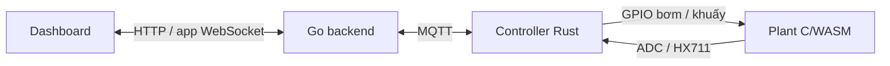

# Máy pha màu 3 bồn

Mô hình định lượng CHINJOO **green 066 / skin 046 / blue 035** theo khối lượng, gồm controller Rust, plant C/WASM cho Wokwi và backend Go với dashboard 2D. ESP32 đọc ba mức bồn và HX711, điều khiển ba bơm cùng bốn bộ khuấy. Backend nhận telemetry và chuyển lệnh qua MQTT.

## Trạng thái

| Thành phần | Kết quả |
| --- | --- |
| Thiết bị native Rust + backend | Hoàn tất kiểm thử mẻ 100 g, dừng và lỗi không có dòng chảy |
| Plant C/WASM | Kiểm thử mô hình, GPIO, ADC, HX711 và framebuffer đạt |
| ESP32 `no_std` trong Wokwi | Đã đọc cân và mức bồn từ plant; Wi-Fi chưa kết nối được, runtime gặp `IllegalInstruction` |
| ESP32 ESP-IDF trong Wokwi | Đạt mẻ thực 100 g qua Wi-Fi, MQTT, HTTP và hai WebSocket |

Vòng ESP32 ESP-IDF → MQTT → dashboard trong Wokwi đã được kiểm chứng một mẻ. Phạm vi, kết quả và giới hạn nằm ở [docs/validation.md](docs/validation.md).



## Chạy trên máy

Cần Go 1.24 trở lên, Rust stable và `curl`:

```bash
HTTP_ADDR=127.0.0.1:8088 make demo
```

Mở **http://127.0.0.1:8088**. Thiết bị native dùng cùng `mixer-core` với firmware ESP32 và một plant phần mềm, gửi telemetry qua MQTT. Đặt mẻ 100 g với tỉ lệ 50/30/20 để quan sát quá trình định lượng. `Ctrl+C` dừng backend và thiết bị. Có thể tăng tốc bằng `SIM_SPEED=10`.

Để chạy riêng backend/dashboard:

```bash
make build-host
HTTP_ADDR=127.0.0.1:8088 make run
```

Backend chờ telemetry từ thiết bị. MQTT TCP mặc định ở `127.0.0.1:1883`, MQTT-over-WebSocket ở `ws://127.0.0.1:9001/mqtt`, WebSocket ứng dụng ở `/ws`. HTTP mặc định dùng cổng 8080 nếu bỏ `HTTP_ADDR`. Mỗi thiết bị trên cùng broker cần `device_id` riêng. Xem [giao thức và cấu hình](docs/protocol.md).

## Build và kiểm thử

```bash
make test
```

Bộ kiểm thử cần thêm Clang với target WASM, trình biên dịch C, Node.js và Python 3. Lệnh chạy Rust, Go với race detector, plant C, WASM và kiểm thử tích hợp qua socket. Bài tích hợp khởi động backend/broker trên cổng ngẫu nhiên và chạy một mẻ native 100 g.

| Lệnh | Tác dụng |
| --- | --- |
| `make build-host` | Build backend và thiết bị native |
| `make build-simulation` | Build custom chip Wokwi |
| `make build-esp32` | Build firmware ESP32 `no_std`, cần toolchain Xtensa |
| `make build` | Build cả ba thành phần trên |
| `make wokwi` | Build và chạy Wokwi CLI, cần `WOKWI_CLI_TOKEN` |
| `make verify-wokwi` | Kiểm tra một ESP32 Wokwi đang trực tuyến và `idle` |
| `make verify-idf-wokwi` | Chạy một mẻ ESP-IDF Wokwi 100 g với backend cô lập |
| `make clean` | Xóa sản phẩm build của dự án |

Hướng dẫn Wokwi: [docs/wokwi.md](docs/wokwi.md). Cấu hình firmware ESP-IDF: [firmware/README.md](firmware/README.md).

## Phần cứng và mô hình

Loadcell giả định **1 kg**, cốc 120 g; mẻ tối đa 875 g. Controller kiểm tra cả khối lượng tổng. Plant dùng ba bồn 1000 ml, mật độ 1 g/ml và bơm 20 ml/s. Sơn và bơm thực tế cần hiệu chuẩn cân, mức bồn, lưu lượng và độ trễ sau tắt. Màu trên dashboard chỉ là minh họa.

[docs/hardware.md](docs/hardware.md) mô tả linh kiện và pinout. [simulation/README.md](simulation/README.md) mô tả phản hồi GPIO/ADC/HX711 và các control gây lỗi. Mô hình phần mềm chưa xác nhận thiết kế điện hoặc khả năng vận hành của máy thật.
